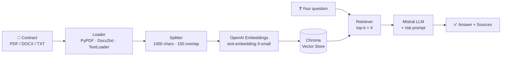

<div align="center">

# ⚖️ Clause IQ

### AI-powered contract risk analyzer

Upload a contract, ask questions in plain English, and get answers grounded in the actual clauses, with the risky ones flagged and the source file cited.


</div>

---

## 📌 Overview

Reading a 40-page contract to find the termination clause, the penalty terms or the auto-renewal trap is slow and easy to get wrong. **Clause IQ** uses **Retrieval-Augmented Generation (RAG)** to do the first pass for you.

It splits your contracts into chunks, embeds them into a local vector database, and retrieves the most relevant excerpts for each question. A Mistral LLM then answers using *only* those excerpts. If the contract doesn't contain the answer, it says so instead of guessing.

> ⚠️ Clause IQ is a research and productivity aid, **not legal advice**. Always have important contracts reviewed by a qualified professional.

## ✨ Features

- 📄 **Multi-format support**: upload `.pdf`, `.docx` and `.txt` contracts
- 🗂️ **Multi-document indexing**: index several contracts at once and query across them
- 🚩 **Risk-aware answers**: the prompt flags liability, termination, penalties, indemnity and auto-renewal clauses
- 🔎 **Source citations**: every answer lists the files it was drawn from
- 🛡️ **Grounded responses**: low temperature (0.2) and a "don't guess" instruction to reduce hallucination
- 💾 **Persistent vector store**: index once, come back later and keep asking
- ⌨️ **Two ways to ingest**: the web UI, or a batch script for a folder of contracts

## 🏗️ How It Works



1. **Load**: the file is read with the right loader for its type.
2. **Split**: text is cut into overlapping chunks so clauses aren't severed mid-sentence.
3. **Embed and store**: chunks are embedded with OpenAI and persisted in ChromaDB.
4. **Retrieve**: the 4 chunks most similar to your question are fetched.
5. **Analyze**: Mistral answers from those excerpts using a contract-risk prompt and returns the answer with its sources.

## 🧰 Tech Stack

| Layer | Technology |
|---|---|
| Frontend | [Streamlit](https://streamlit.io) |
| Orchestration | [LangChain](https://www.langchain.com) (`RetrievalQA`) |
| LLM | [Mistral AI](https://mistral.ai), default `open-mistral-7b` |
| Embeddings | OpenAI, default `text-embedding-3-small` |
| Vector database | [ChromaDB](https://www.trychroma.com) (local, persistent) |
| Document parsing | `pypdf`, `docx2txt`, LangChain `TextLoader` |

## 📁 Project Structure

```
clause-iq/
├── app.py              # Streamlit web app (upload, index, ask)
├── ingest.py           # Batch-index every contract in the data/ folder
├── document_loader.py  # Load PDF/DOCX/TXT and split into chunks
├── vector_store.py     # Build and load the Chroma vector store
├── retriever.py        # Top-k retriever over the vector store
├── risk_analyzer.py    # Prompt, Mistral LLM and RetrievalQA chain
├── config.py           # Environment variables and tunable settings
├── main.py             # Quick-start hints
├── .env                # Your API keys (not committed)
├── data/               # Uploaded / ingested contracts
└── vector_store_db/    # Persisted Chroma index
```

## 🚀 Getting Started

### 1. Clone the repository

```bash
git clone https://github.com/<your-username>/clause-iq.git
cd clause-iq
```

### 2. Create a virtual environment and install dependencies

```bash
python -m venv venv
source venv/bin/activate        # Windows: venv\Scripts\activate

pip install streamlit python-dotenv chardet pypdf docx2txt chromadb \
            langchain-core langchain-classic langchain-community \
            langchain-text-splitters langchain-openai langchain-mistralai \
            langchain-chroma
```

> 💡 Once everything works, run `pip freeze > requirements.txt` so others can install with a single command.

### 3. Add your API keys

Create a `.env` file in the project root:

```env
OPENAI_API_KEY=your_openai_key      # used for embeddings
MISTRAL_API_KEY=your_mistral_key    # used for answering
```

### 4. Run the app

```bash
streamlit run app.py
```

Open the local URL Streamlit prints (usually `http://localhost:8501`).

## 🕹️ Usage

**In the web app**

1. Use the sidebar to upload one or more contracts (PDF, DOCX or TXT).
2. Click **Process documents** and wait for the "Indexed N document chunks" message.
3. Type a question and click **Analyze**.

**From the command line (batch mode)**

Drop your contracts into the `data/` folder and run:

```bash
python ingest.py
```

Then launch the app and start asking questions against the saved index.

### 💬 Example questions

- *What are the termination and penalty clauses?*
- *Does this contract auto-renew? What is the notice period to cancel?*
- *Who bears liability if the services are delayed?*
- *Is there an indemnity clause, and who does it protect?*
- *Summarize the payment terms and late-payment consequences.*

## ⚙️ Configuration

Set these in `.env` to override the defaults:

| Variable | Default | Description |
|---|---|---|
| `OPENAI_API_KEY` | none (required) | Key for OpenAI embeddings |
| `MISTRAL_API_KEY` | none (required) | Key for the Mistral LLM |
| `EMBEDDING_MODEL` | `text-embedding-3-small` | OpenAI embedding model |
| `MISTRAL_MODEL` | `open-mistral-7b` | Mistral chat model |
| `VECTOR_STORE_DIR` | `vector_store_db` | Where the Chroma index is saved |
| `DATA_DIR` | `data` | Where contracts are stored |


